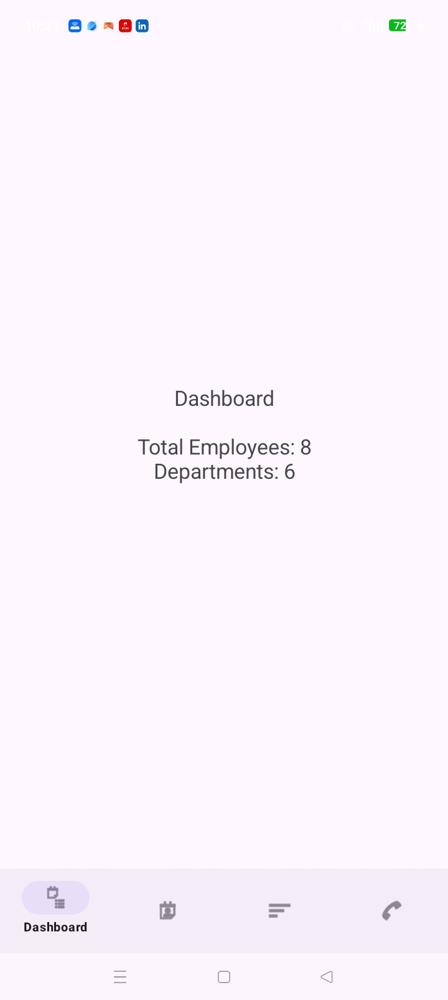
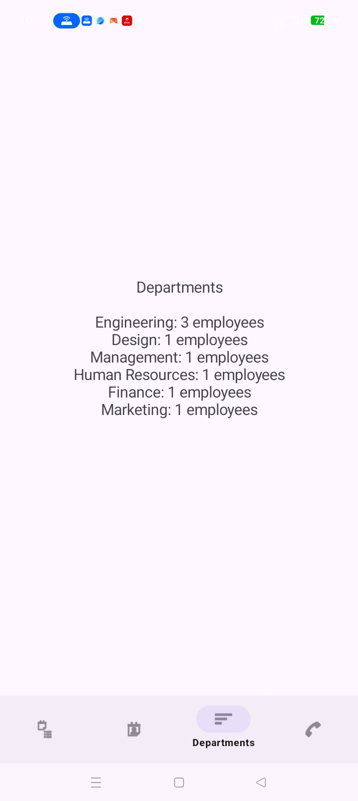
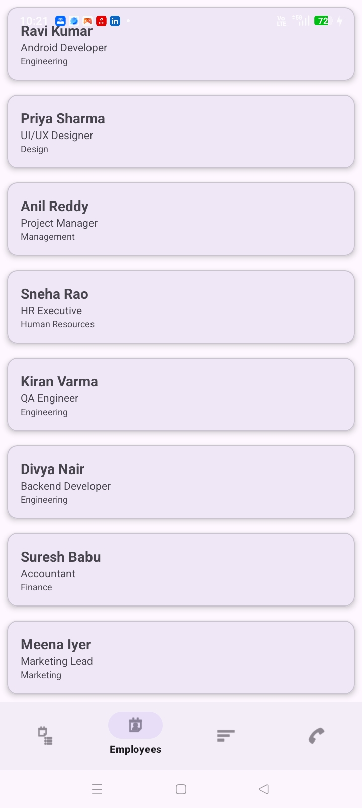
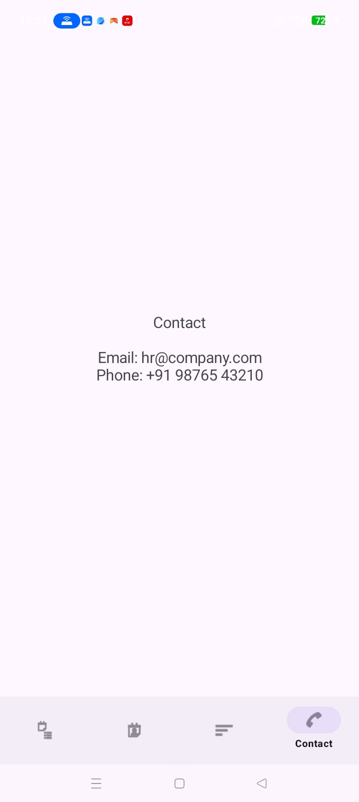

# Employee Directory App

A dynamic Employee Directory Android application built with Kotlin, RecyclerView, Fragments, and Navigation Component, following Material Design 3 guidelines.

## Features
- Dashboard
- Employee List (RecyclerView with Material Cards)
- Departments
- Contact Screen
- Bottom Navigation
- Fragment Navigation using Navigation Component
- View Binding

## Tech Stack
- Kotlin
- Android Studio
- RecyclerView & Custom Adapter
- Fragments
- Navigation Component
- View Binding
- Material Design 3
- Git & GitHub

## Screenshots

| Dashboard | Employees |
|-----------|-----------|
| 

 | 

 |

| Departments | Contact |
|-------------|---------|
| 

 | 

 |

## Project Structure
- `activities/` - MainActivity
- `fragments/` - Dashboard, Employees, Departments, Contact
- `adapters/` - EmployeeAdapter
- `models/` - EmployeeData
- `res/` - layouts, navigation, menu, drawable

## How to Run
1. Clone the repository:
   `git clone https://github.com/mohanadodda2005/EmployeeDirectory.git`
2. Open the project in Android Studio.
3. Sync Gradle and run on an emulator or physical device.

## Author
Mohana Dodlakula
